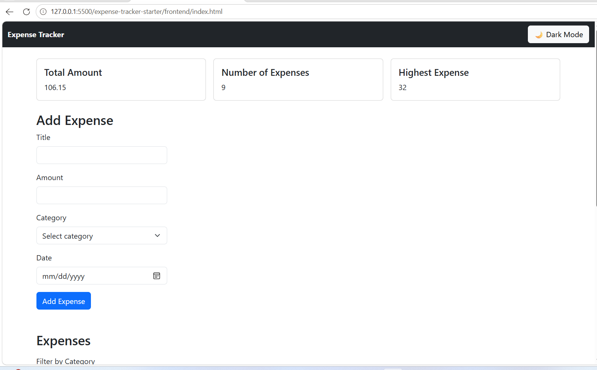
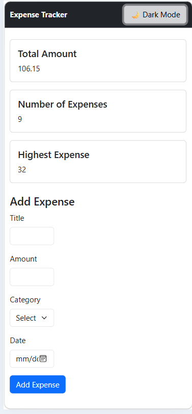
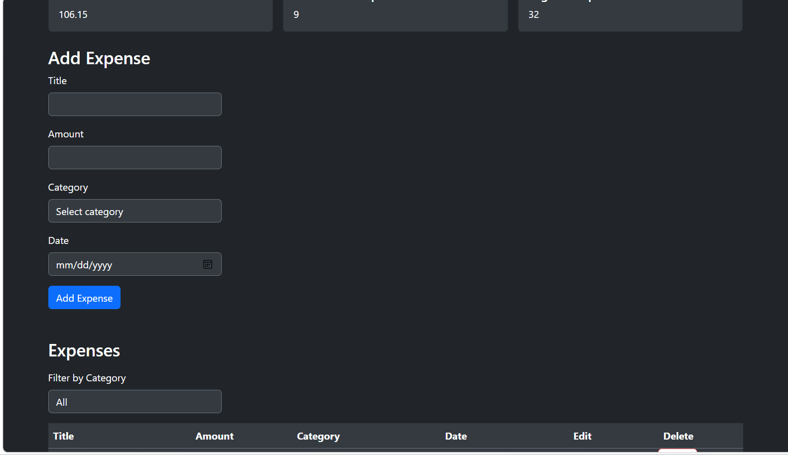

# Expense Tracker

Expense Tracker is a simple web application for managing daily expenses.
Users can add,edit,delete and filter expenses and view the total amount and number of expenses and highest expense.

## How to run

<!-- Write the exact steps someone needs to run your project from scratch.
     Assume they have Node.js, PostgreSQL, and VS Code, and nothing else.
     Include: creating the database, running schema.sql, writing the .env file,
     starting the backend, and opening the frontend. -->

**Backend**

1.On pgAdmin create new database named with (expense_tracker) and then run the code in schema.sql to create the table and insert value.

2.Open the backend folder in the terminal
cd (backend folder path)

3.Install the required packages when needed

4.Create a .env file inside the backend folder with this value:
DB_HOST=localhost
DB_PORT=5432
DB_USER=postgres
DB_PASSWORD= your database password
DB_NAME=expense_tracker

4.Start the backend using : node server.js

Then the backend API will run on:
http://localhost:3000

**Frontend**

1. Open the frontend folder in VS Code.

2. Open index.html using open with Live Server.

3. The Expense Tracker application will open in the browser.

## Features

<!-- List what your app can do. Tick what you finished. -->

- [✓] Add an expense (with validation)
- [✓] Delete an expense
- [✓] Edit an expense
- [✓] Filter by category
- [✓] Summary cards (total, count, highest)
- [✓] Data is saved in a PostgreSQL database
- [✓] Dark mode

## Screenshots

## What was the hardest part?

The hardest part was the backend because it was new to me. I read the topics mentioned in the roadmap, learned how they work, and practiced them while building the project.

## demo link

[demo link](https://drive.google.com/file/d/1k440ZYSGcXoWM8m6zpyoIn7EyvBVKvmG/view?usp=drive_link)
